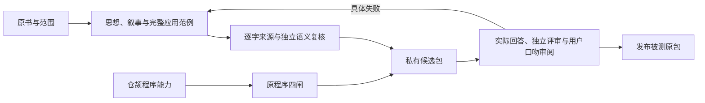

# book-workflow

book-workflow 0.3.0 将书籍、长视频或播客蒸馏成可用于新问题的 Skill：书中思想参与理解、推演与修正，叙事方式和口吻参与成文。原文证据与程序卡为回答提供查证和执行支持。



机械检查在本地执行；思想忠实、迁移推演与口吻需要原文语义复核和实际回答验证，不能由引文命中或字段齐全代替。没有程序的作品可以走思想与叙事路径；程序四闸经核实记不适用。

本仓库既是工作区，也是插件开发现场。共同源为 [cloudxy/book-plugin](https://github.com/cloudxy/book-plugin)，五端共用仓内源文件，改完开新会话刷新。接入、许可证与维护纪律见 [AGENTS.md](AGENTS.md)。

## 五端使用

| CLI | 全流程 | 只审计 | 只出图 |
|---|---|---|---|
| Codex | `$book <原文路径>` | `$book-audit --task <slug>` | `$book-diagram <描述>` |
| Kimi | `/skill:book <原文路径>` | `/skill:book-audit --task <slug>` | `/skill:book-diagram <描述>` |
| Claude / Grok / ZCode | `/book <原文路径>` | `/book-audit --task <slug>` | `/book-diagram <描述>` |

也可直接描述“拆书并审计”“补蒸馏思想与文风”或“继续”。Codex 显示插件命名空间时，按 `/skills` 使用完整名称，如 `$book-workflow:book`。Claude、Codex、Kimi、Grok 在本目录的新会话使用项目挂载；ZCode 通过 `plugins.dirs` 直接注册本目录，其他机器克隆仓库后注册自己的克隆。

首次使用按宿主完成项目信任。技能本体是 [skills/book-workflow/SKILL.md](skills/book-workflow/SKILL.md)，快捷技能只转到 commands。解析软链后定位插件根，不从挂载路径推算脚本位置。

## 运行路径

1. **整书阅读。** 固定原文版本、译者和范围，独立建立重要思想、论证、分歧和表达样态的覆盖底账。缺原文不蒸馏，污染与未核实章节单独登记。
2. **联合重建。** 写连贯思想核心、概念关系与思想动作；从上下文提取视角、展开次序和口吻。完整范例展示原书如何形成认识、怎样迁移以及条件变化怎样改判。
3. **程序与出图。** 适用程序沿仓颉阶段0–4产出 Bundle，按房规绘 SVG。无程序不凑空 Bundle。四件 vendor 源码保持原样。
4. **来源核查。** 引文与上下文逐字匹配，独立复核语义、说话者、关系、核心、表达、范例和覆盖。程序另走桥接与四闸。
5. **候选和实测。** 候选入口内嵌思想及口吻，按需读扩展模型和范例。干净会话实答未见任务，比较旧版、无该书 Skill、检索基线与新版，独立评审实际输出。
6. **验收和发布。** 思想、推演、效用与表达分别达标，用户审阅目标口吻后发布与实测完全一致的候选。缺输出或评审时保持待完成，保留断点。

新整书产品初版只有一个发现入口。程序调用索引未命中，不代表思想不适用；原 single 编译器“一张卡、未命中即停”的总路由不进入整书组合包。用户明确选择原程序 single/pack 时，保留该模式，其通过结果只描述程序能力。

## 文件与边界

```text
skills/book-workflow/
  SKILL.md                         主运行合同
  references/distill-thinking.md   思想、叙事、证据和范例的实际格式
  references/evaluate-and-publish.md 真实回答、评审与发布协议
commands/                          book、book-audit、book-diagram
bridge/
  thinking_audit.py                 逐字/结构核验及哈希绑定的语义评审
  build_book_skill.py               candidate / verify / publish / procedures
  eval_book_skill.py                prepare / collect / score-structural / report
  book_skill_common.py              版本、输入与交付包合同
  cangjie_to_dsh.py                 程序桥接与逐字回源
  run_audit.py                      原四闸及绑定输入的机器回执
  check_diagrams.py                 SVG 引用与 lint
  render_html_image.py              可选栅格出图
scripts/bootstrap.py               按工作区自举，幂等
tests/                             原程序 e2e、新合同回归与原创合成夹具
docs/                              设计与验收方法，不作为技能加载
vendor/                            固定随包依赖，不修改其源码
books/ .work/                      私有源文、蒸馏、候选、回答与评审
tools/ .dsh/ .venv/                自举生成的工作区运行件
```

书籍产物：

```text
books/<slug>/
  BOOK_OVERVIEW.md  coverage-audit.md  PIPELINE_STATE.md
  thinking/model.yaml  thinking/EXAMPLES.md
  thinking/CORE.md                  生成视图，不手改
  expression/PROFILE.md
  evidence/anchors.yaml
  .cangjie/capabilities/            有程序时存在
  eval/                            保留题、实际回答和评审不进入运行包
```

`books/`、`.work/`、`.venv/`、`tools/`、`.dsh/` 不进远端。候选与正式包不默认复制整书；短证据和上下文元数据随包，查全文可配置用户的本地来源。编译与验收清单绑定输入和文件哈希，修改后旧通过记录失效。

## 环境与命令

Python ≥3.10，PyYAML、PyMuPDF、html-css-to-image 0.3.0；Node 用于 svg-lint。工作区自举：

```bash
python3 scripts/bootstrap.py <工作区根>
make doctor
make e2e                 # 原程序 12 项 + 新思想/构建/验收合同测试
```

拆书本身由宿主按技能读取原文和写入思想内容，CLI 不会用正则自动生成书的思想。文件合同见 [重建指南](skills/book-workflow/references/distill-thinking.md)。

```bash
# 来源与结构通过后，生成待独立复核的逐项模板；退出3表示待复核
.venv/bin/python bridge/thinking_audit.py --book-dir books/<slug> --source <原文> --ws . --prepare-review books/<slug>/eval/source-review.json

# 独立语义复核完成后
make thinking-audit BOOK=books/<slug> SRC=<原文> REVIEW=<评审.json>

# 有程序时先桥接和四闸；无程序须有范围依据并经独立复核
make bridge BOOK=books/<slug> SRC=<原文>
make audit TASK=<slug>

# 新整书路径：候选、实际回答与独立评审、发布
make candidate BOOK=books/<slug> SRC=<原文> REVIEW=<评审.json>
.venv/bin/python bridge/eval_book_skill.py prepare --candidate <候选目录> --suite <cases.yaml> --run-dir <评测目录>
.venv/bin/python bridge/eval_book_skill.py collect --run-dir <评测目录> --case C02-01 --answer <真实回答.json>
make eval-report RUN=<评测目录>
make publish CANDIDATE=<候选目录> ACCEPTANCE=<评测目录/acceptance.json> OUT=<安装目标>

# 用户明确选择的原程序 single/pack；同样检查当前四闸回执
make compile BOOK=books/<slug> OUT=<目标> OUTPUT=single
```

prepare 只准备盲测输入；collect 只收集实际输出；score-structural 只查结构；report 才汇总独立语义与用户表达审阅。退出0表示该命令范围完成，退出1失败，report 或 thinking-audit 退出3表示待完成。完整评分协议见 [评测与发布](skills/book-workflow/references/evaluate-and-publish.md)。

## 出图与程序四闸

SVG 先读 `vendor/svg-diagram/SKILL.md`，使用房规字体、语义配色、盒距与曲线，lint error 清零。能力图放 Bundle `resources/` 并显式声明，overview/digest 图放 `assets/` 相对引用。

```bash
make lint-svg FILE=<图.svg>
```

四闸分别检查 G-66 池覆盖、G-67 日期锚、G-68 证据闭包、SVG 引用及 lint；各自不能证明整书思想和口吻已通过。回源/G-67 修 R 层，G-66 补采或复核淘汰，G-68 重建证据包及查 id 映射，图件失败修图补引用。

html-css-to-image 是可选栅格客户端，只在明确要求且有 `HCTI_API_ID` 与 `HCTI_API_KEY` 时处理书树外 HTML/CSS；无密钥不调用，不进四闸。dsh 侧 AGPL 源码保持完整且不修改，通过进程级调用组合；其他 vendor 的许可证与再分发边界见 AGENTS。

## 0.3.0 的验证范围

自有审计、候选构建、评测记录与发布限制已接入。合同回归使用原创合成夹具，验证缺失、篡改和旧评审复用会被拦截；这些测试不代表真实书籍已经会思考。

真实书籍试点在私有目录进行，范围、实际输出、失败及用户口吻状态分别记录。旧书不会因插件升级自动完成思想和文风补蒸馏。设计背景、完整示例和15组验收方法见 [docs/README.md](docs/README.md)。
