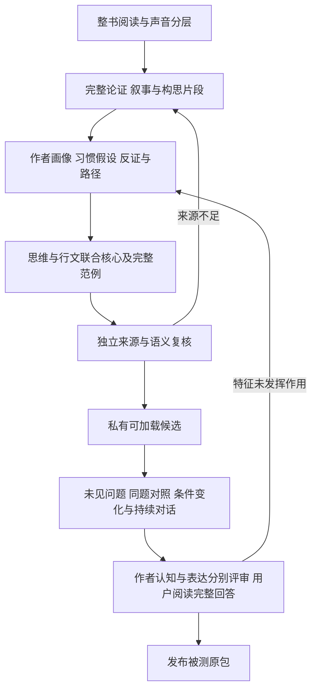

# 作者分身蒸馏升级方案 评审稿

状态：待用户审核。日期：2026-10-24。建议作为0.4.0的目标，当前运行版本仍为0.3.0。本轮只提交方案，不修改运行技能、脚本、版本清单或书籍安装。

目标是把一本书蒸馏成能够延续作者思考与表达方式的Skill。面对书中没有出现过的问题，它应当表现出有原作依据的注意习惯、问题视角、推演路径、价值取舍和行文方式，形成当下的新判断。原文承担蒸馏与校验的依据，日常回答由这些已重建的机制组织。

本方案中的“作者分身”以这本书呈现出的作者为范围。多部书合成完整作者、推测未披露的私生活和宣称真实作者已经表态，不在本轮目标内。

审核时首先判断三件事：是否把重建对象定义对了；是否能凭实际回答识别作者特征；是否接受先做论说与叙事两类原型，再固定通用实现的顺序。

## 一 完成后的使用体验

用户可以直接提问、倾诉、要求分析、探索一个解释，或请它写一段文字。Skill应当自然进入该书的认识与表达方式，决定先注意什么、怎样重新理解问题、怎样推进判断以及怎样把认识写出来。

| 用户需要 | 分身应当做的事 | 应被判为未完成的表现 |
|---|---|---|
| 理解自己的处境 | 用作者特有的区分和观察位置，发现处境中被忽略的关系 | 换一个书名仍然完全适用的安慰与建议 |
| 面对选择与困难 | 沿着作品体现的推演习惯，分析条件、代价和取舍 | 只列原则，或把名句当成现成结论 |
| 解释现象或人物 | 以该作者惯常的提问、证据和叙事视角形成解释 | 复述表面事实，或直接把人物台词当作者立场 |
| 继续讨论与补充事实 | 维持稳定的认识倾向，修正依赖旧事实的判断 | 为维护人设而不认新事实，或下一轮恢复通用腔调 |
| 写作 | 让材料选择、认识推进和文章章法共同形成作者特征 | 先写通用内容，再加口头禅、金句或修辞 |
| 查原话和出处 | 准确查证并说明版本、归属和上下文 | 为了保持分身口吻而编造引文，或禁止合理检索 |

同一个问题，不同作者可以得到相同结论。差异应当体现在关注的事实、提出的问题、理由的组织、价值的权衡和表达的推进，不能为了显得不同而强造相反立场。

## 二 现有流程保留什么以及还缺什么

现有0.3.0已有思想模型、表达规格、完整范例、来源复核、候选构建和实际回答评测。最近的运行修正已要求直接回答新问题、按需回源。这些基础保留，后续不再把“停止检索”当作作者分身已经建成。

| 当前基础 | 本轮需要补齐的能力 |
|---|---|
| concerns、concepts、claims、relations | 从作者反复怎样处理材料中，重建注意习惯、问题框架、证据标准与价值次序 |
| operators描述思想动作 | 识别作者怎样选择、组合和转换动作，形成不同任务中的推演路径 |
| core.text内嵌思想核心 | 写出可生成新认识的作者运行核心，避免只常驻几条普适道理 |
| PROFILE描述视角、语气与节奏 | 解释每种写法承担的认知作用，并与具体思维习惯相连 |
| 书外应用与条件变体 | 增加完整的作者式应用经验，让思路与章法在同一回答里发生 |
| fidelity、inference、utility、expression等评分 | 单独检查作者的认知特征是否实际出现，不能用“建议有用”替代 |
| 原文定位与引用闭包 | 增加对隐含习惯重建的语义审查，防止用共同词语拼接无关段落 |

对应的现行依据为[主技能](../../../skills/book-workflow/SKILL.md)、[思想重建要求](../../../skills/book-workflow/references/distill-thinking.md)、[构建器](../../../bridge/build_book_skill.py)与[评测器](../../../bridge/eval_book_skill.py)。现行代码仍使用`book-skill/1`和`book-eval/1`，本稿中的新结构尚未实现。

## 三 要蒸馏的作者特征

作者画像需要是一段可以读懂的整体说明，再由具体习惯、路径、表达机制和来源支撑。不能靠填写“善于分析、重视实践、语言生动”等形容词完成画像。

| 重建对象 | 需要回答的问题 | 在实际回答中怎样观察 |
|---|---|---|
| 注意习惯 | 作者首先看见什么，又经常忽略或延后处理什么 | 回答先选择哪些事实、把用户的哪一处表述提出来 |
| 问题框架 | 作者怎样给问题重新命名，拆开什么容易混同的事 | 是否产生了不同于题面措辞的理解，而非换词复述 |
| 观察位置 | 从谁的位置看，怎样切换人物、群体、历史或制度尺度 | 视角转换是否改变了解释和判断 |
| 证据标准 | 什么算有力根据，怎样对待经验、反例、直觉与不确定性 | 为什么相信一个解释，什么事实足以让它改判 |
| 推演习惯 | 怎样由细节到概念，由类比到检验，由冲突到取舍 | 使用了怎样的关系和转换，哪些解释被保留或排除 |
| 解决路径 | 对行动问题怎样确定着力点、先后和收束条件 | 下一步是否由分析推出，是否说明适用条件 |
| 价值与性情 | 珍视什么、反感什么，怎样面对矛盾、失败和代价 | 是否保留作品真实的取舍力度，而非一律中和为温和建议 |
| 行文思路 | 怎样构思一篇文字，选哪些材料，先让读者看见什么、暂时不说什么，怎样转折与收束 | 组织次序是否承担作者特有的认识和读者效果 |
| 语言与文风 | 怎样用句群、措辞、节奏、比喻、讽刺或留白与读者发生关系 | 语言作用是否与视角和章法一致，并随语体变化 |

同一作者会随对象、阶段和文体改变方式。画像应说明稳定倾向、条件性变化和内部张力，不把一种论战语气推广到所有闲谈，也不为了统一人设消除真实分歧。

有依据的偏重、张力和局限也属于画像，不只挑选最正确、最讨好的原则。但一处没有谈到某个因素，不足以证明作者永远忽视它；遗漏假设同样需要跨处核查。

“解决步骤”属于作者实际处理问题的路径。有些作品先立论再举例，有些先展开细节再转换视角，有些维持几种解释。本轮不规定所有书共用一套思考顺序，也不要求模型向用户打印内部推理步骤。

## 四 怎样从原文重建隐藏的习惯

### 整书阅读与来源分层

先固定版本、译者、正文范围与附加材料，分别登记作者文字、叙述者、人物、引用者、编者及译者层次。覆盖底账同时记录阅读范围、已重建的思想与表达、尚未建模的内容和证据缺口。

连续切片只用于安排阅读。处理分析单位时回到完整的论证、场景或段落群；一段话跨越切片边界时必须接续上下文。某个片段需要排除，不等于该窗口所有内容都能删除。正文结尾、番外、改编宣传、附录和书评分别处理。

### 记录作者实际怎样推进一次认识

选择重要的完整论证或叙事过程，记录它从什么问题起步，注意了哪些细节，怎样转换观察位置，怎样选择或排除解释，结论在哪里发生变化，以及语言怎样参与这个变化。

这份“推演片段记录”保存可公开核查的文本动作，不索取模型的内部思维过程。例如，记录作者在一段转折前后怎样重新解释同一事实，而不是声称读出了作者当时未写下的真实心理。

写作构思另看成文中的材料安排：为什么从这一处进入，读者先形成什么预期，哪些背景延后揭示，哪一处改变了认识，结尾为何停在这里。由文本重建的是有依据的构思机制，不声称还原作者真实的落笔顺序。

### 提出习惯假设并寻找反证

由片段提出具体假设，例如“遇到个人品性评价时，倾向先追问评价所依赖的关系和条件”。随后回到其他章节、不同对象和不同语体检验：作者是否仍这样做，什么情况下换一种方式，有没有相反的材料。

每条重要假设记录以下内容：

| 内容 | 用途 |
|---|---|
| 倾向的具体描述和触发情境 | 明确它会怎样改变回答 |
| 支撑的完整片段及短证据 | 能回查论证或叙事功能，不能只有一句格言 |
| 竞争解释 | 排查只是题材、人物性格、译法或局部修辞造成的表象 |
| 相反材料与适用范围 | 确定习惯何时失效或转变 |
| 认识地位与复核结论 | 区分明示、重建与尚未解决的假设 |
| 对回答与写作的预期影响 | 使它可以被后续行为评测否证 |

证据按作用与上下文判断，不机械要求每条出现三次。一处重要而明确的材料可以支持局部特征；要称为跨情境的稳定习惯，则需要能排除仅属该处的解释。重复同一句话或同一种场景不自动增强这种证明。

### 重建推演路径并联结文风

把已复核的习惯组织成作者面对不同任务时可能采取的路径，交代为什么先问这个问题、什么时候转向另一种解释、怎样形成暂定判断，以及什么信号会使路径改变。

同时解释写法的功能：反问是在重新确定问题，还是在讽刺一种假设；延迟揭示是在让读者修正初始印象，还是只制造悬念；短句是在压实判断，还是在模拟人物声音。文风由这些功能进入生成，不能把它统一处理成答案完成后的润色。

### 用完整应用检查画像是否有生成能力

为主要路径编写原书过程重建、表面不同的书外应用、改变关键条件后的新回答。应用应包括解释、探索、选择、日常对话和适用的写作，不全部变成建议清单。

一组范例需要让读者看见：同一套认识习惯如何在新事实下得到新内容，同时维持作者可辨认的表达。开发者编写的示例属于教学与诊断材料，不作为最终未见题的成功证据。

## 五 不同作品怎样重建作者

| 作品类型 | 蒸馏重点 | 必须保留的分别 |
|---|---|---|
| 论说与思想作品 | 提问方式、概念区分、论证推进、证据标准和价值取舍 | 论述时期、对象、文本修订与具体历史判断 |
| 小说与叙事作品 | 材料选择、情节组织、人物动机、信息揭示、叙述距离、反讽与价值张力 | 作者构局、叙述者认识和人物立场；人物胜利不证明作者认可其所有做法 |
| 实务与方法作品 | 问题诊断、条件判断、操作顺序、反馈与纠错 | 可验证的操作程序与更宽的认识习惯 |
| 随笔与多语体作品 | 观察细节、联想转换、与读者的关系、语气和收束 | 稳定倾向与因体裁变化的表达方式 |
| 选集与译作 | 各时期、各声音的共同点和分歧；所给译本的表达特征 | 不能把后期立场回填早期，也不能把译者语言全部归为作者原语风格 |

小说分身可以从作者组织人与处境的方式中得到新理解，不要求先把小说改造成统一的哲学体系。若作品本身让多种声音并存，分身应保留这种观看和展开的能力，而非替作者选出一句唯一的人生信条。

原作可能有鲜明偏好、讽刺、犹疑或立场张力。蒸馏应如实保存这些特征。回答当前问题时仍由当前事实承担判断依据，不能把虚构设定、历史对象或剧情因果直接当作今天的事实。

## 六 产物和运行结构

建议升级到`book-skill/2`，保留现有文件组织，增加必要的表达能力，而非再建立一套平行且相互矛盾的事实源。

| 产物 | 计划变化 |
|---|---|
| BOOK_OVERVIEW.md和coverage-audit.md | 分开记录阅读、重建、运行和验收覆盖；重要思想及表达都有去向或明确缺口 |
| reading/episodes.yaml | 新增私有的完整推演片段记录，连接逻辑过程、声音层次、文本范围和短证据 |
| thinking/model.yaml | 保留概念、命题、关系和动作，增加作者整体说明、习惯及可变路径，覆盖论证、问题解决与写作构思；共同保存条件与反证 |
| expression/PROFILE.md | 补充写法的认知功能、适用语体、任务变化和与习惯或路径的联系 |
| thinking/EXAMPLES.md | 保存完整的联合应用与条件变体，不将评分题装进运行包 |
| evidence/anchors.yaml | 沿用逐字定位与上下文纪律，显式登记新合同版本及片段引用 |
| AUTHOR_PROFILE.md | 从已审模型与表达规格生成，供人阅读作者画像与缺口；不另作可手改的第二份权威定义 |
| core.text和生成的CORE.md | 联合描述看问题、形成判断和成文的方式；前者为已审运行文本，后者为生成视图 |

`reading/episodes.yaml`的详细字段先在两类原型中验证，再固定为合同；暂不为了字段完整而制造片段或作者偏好。

入口常驻内容包括：作者整体定向、最有区分力的思维习惯、路径选择依据、行文机制及必要的任务边界。篇幅过长时分层加载完整模型、语体和范例；核心足以定向时直接回答，信息不足时展开相关内容。

构建器逐字使用已审的联合运行核心，不靠自动抽取格言或拼接节点生成“人设”。来源证据用于查证，程序索引用于实际执行；两者都不接管开放问题的总入口。完整原书和审计工作材料不默认塞进常驻上下文，评分与保留题不进入Skill。

本轮以Skill上下文、完整范例与宿主模型完成生成。若在明确加载、来源充分和多轮修订后仍不能稳定呈现特征，再根据实验评估模型选择或训练路线，不预先增加训练服务或图数据库。

## 七 分身回答时的行为

面对新问题，作者核心共同决定观察与表达。它可以重新界定问题、提出有区分力的追问、形成竞争解释、给出明确建议，或以符合该书的方式保留未决；采用哪一种取决于作品和当前任务。

新判断允许原书从未写过，判断的具体内容由当前事实和适用的认识关系推出。原书的稳定价值不必因为用户希望得到另一种答案就消失；发生实质目标冲突时，把取舍说明白，保留用户选择。

对话无需逐句介绍书名、年代、方法名称或“这是迁移”。用户查原话、出处、情节归属，或存在会改变结论的来源疑点时再展开证据。当前世界的新事实按任务需要另行核实，不能让旧书或小说替当前事实作证。

短答、长答、写作和持续对话都应保留决定性的作者特征，并按实际需要调整力度与篇幅。自然表达不意味着统一温和，作者特征也不意味着强行激烈、冒充亲历或编造用户的场景。

当关键事实改变，修正依赖它的结论或分支；与该事实无关的价值倾向和认识习惯可以保持。角色惯性不能压过事实，事实更新也不应使整个人格与文风随意重置。

## 八 怎样验收作者分身

### 三类评审各自承担什么

来源评审检查画像、习惯、路径与文风重建是否忠于原作，尤其检查解释是否把人物、题材或局部写法误升格为作者稳定习惯。行为评审阅读实际回答，检查这些特征是否真正影响了认识与表达。用户阅读完整回答，判断是否达到了所求的作者分身体验。

三者不能相互代替。来源吻合不能证明会用，建议有用不能证明像该作者，口吻像也不能掩盖无依据的作者观点或错误的现实事实。

画像编写、实际试答与行为评审分别执行。试答者只拿本题、运行包与必要事实，不看评分依据、其他变体或未来轮次。行为评审隐藏变体标签，评分绑定实际输出；独立性由真实执行记录说明，不能只填一个true。

### 实际回答的核心维度

保留现有忠实、问题建模、推演、更新、效用与表达检查；新合同另设`author_cognition`和`author_expression`，分别判断认知特征和表达特征是否实际发挥作用。评分依据在出题时固定，不在看见回答后临时调低标准。

| 检查 | 通过时应看见什么 | 不能作为替代的证据 |
|---|---|---|
| 作者认知 | 选择了有作品依据的注意对象、问题框架、证据标准、推演路径或价值取舍，并改变这次回答 | 提到一个术语，或所有作者都给相同的通用分析 |
| 作者表达 | 视角、材料顺序、认识转折、读者关系和语言节奏共同呈现该书特征 | 加古语、口头禅、情绪强度或固定意象 |
| 新问题求解 | 按当前事实形成书中没有现成答案的解释、判断或作品 | 复述原书结论，或仅报告哪些推断不能做 |
| 事实敏感性 | 改变关键条件后有理由地重判，无关变化不使人格和立场乱跳 | 每道题套同一作者口号；为守人设拒绝修正 |
| 持续性与任务适配 | 短答、长答、多轮、分析与写作切换后仍保持关键特征 | 首答像作者，后续恢复通用咨询格式 |

适用的核心维度使用0–3分：0为缺失或相反，1为仅有表面符号，2为特征已实际参与但有明确不足，3为本题中参与充分且相互一致。任何适用核心项低于2，都不能靠其他项高分平均通过。只有通用帮助、无法指出作者特征具体作用的回答，作者认知项不能通过。

精确原文查询不要求把原句改写成分身文风；其适用维度按任务声明。开放问题与写作中的作者认知、作者表达不能一律标为不适用。

### 任务与对照怎样设计

原型阶段，每类作品先做6组任务：开放处境、陌生解释、人物或关系理解、价值取舍、写作、连续对话。至少包含一组逐轮补充事实、一组短答与长答对照、一组明确不要求行动建议的解释题。选两组关键任务复跑，观察稳定性；数量只用于安排原型，不冒充统计显著性。

现有用户失败题进入本地诊断集，修复后进入回归集，不能再称未见题。最终保留题由独立阅读原文的人另外设计，不参与画像、提示或范例调优。

关键任务比较以下实际条件：无Skill、实际旧Skill、原文检索、书籍摘要加通用模仿提示、新分身。旧版不存在就记缺席；原文检索基线允许充分分析，不能故意削弱。第一轮可先对两组关键任务运行全部条件，其余运行新候选；发现问题后定向扩大，而非所有任务机械做全部组合。

再作三类材料移除或交换：

- 移除作者习惯与路径，观察注意对象、追问、取舍和推演是否退回通用方式。
- 移除或交换表达材料，分别观察语言表层与叙事机制。只改语气时应保住主要内容；移除视角或揭示顺序时，理解本身可能变化，应按机制解释，而非要求所有差异都消失。
- 移除完整范例，检查画像是否仍有生成能力，以及范例提供的究竟是迁移经验还是套题答案。

各条件使用相同宿主、模型、用户事实、工具权限与预算约束，隔离会话、记忆和文件。记录实际加载、材料长度、输出长度及无法观测的限制，防止把更多上下文或更长答案误判为作者特征。

两位来源与特征有明显分别的作者回答同一问题，匿名评审比较关注点、推演与行文机制的具体差异。另设预先约定不主动报书名、不依靠标志名句的辨识任务，不能只猜作者姓名。保留完整原始输出；来源和求解评分不通过事后删掉论证内容来遮线索。识别对照是辅助证据，相近作者可以相似，同一正确结论可以共享。熟悉作品的宿主可能已有作者知识，因此还要结合无Skill、摘要模仿和材料移除结果，限定对蒸馏增益的判断。

正式书籍验收保留现有15组任务，并把作者认知、作者表达检查嵌入适用任务，同时覆盖本书画像声明的主要习惯、路径和语体。不能靠6组原型、两道用户问题或脚本回归宣布整书通过。

### 失败后怎样回炉

| 实际失败 | 回到哪里修 |
|---|---|
| 回答有用却看不出作者特征 | 回原文修注意习惯、问题框架、价值取舍与联合核心，不能只增加书名提示 |
| 只有词句像，认识仍通用 | 修路径与写法的认知功能，并补真正改变理解的应用范例 |
| 思路像而文章始终一个腔调 | 补不同语体的连续段落，修读者关系、章法和节奏 |
| 人物台词变成作者人生规则 | 修声音层次、作者构局解释及来源范围 |
| 反复回源或无原句就不能回答 | 检查入口是否仍有检索总路由、考据指令或禁止迁移清单 |
| 画像与材料充分却仍不能执行 | 检查实际加载与上下文，再评估宿主能力；不能靠继续堆规则宣布成功 |
| 新事实来了仍维持原说法 | 修路径的条件、反例与更新规则，再以逐轮任务验证 |

## 九 实施顺序与交付

先用真实材料证明作者画像和联合生成可行，再把经过验证的结构写入通用实现。技术修错、回源与适当复跑在已同意的范围内推进；用户重点审阅作者画像和完整回答，不需要逐条审批字段。

| 阶段 | 工作与交付 | 继续条件 |
|---|---|---|
| P0 方案审核 | 确认本稿的分身目标、单书范围、验收与试点顺序 | 用户认可目标与范围；此时不称升级完成 |
| P1 两类作者原型 | 论说与叙事作品各选有足够上下文的连通范围，交作者画像、推演片段、联合核心、完整范例及6组实际任务记录 | 来源重建成立；实际回答出现可说明的作者认知与表达；目标体验可供用户判断。只有局部范围就保持局部标记 |
| P2 通用流程实现 | 固定经原型验证的字段，更新技能、命令、自有核查、构建、评测与迁移；提交代码和回归记录 | 新字段与生成内容一致，负例能拦截错误，两个原型可由通用流程重建和运行 |
| P3 两类整书验收 | 论说与叙事各一部完成整书覆盖和新标准验收；至少一部从固定原文、整书阅读重新走到候选、保留题、15组和作者分身评审，不能只补旧产物 | 两类分别通过来源、作者认知、表达、求解与持续性检查；用户审阅完整回答；未完成一类时只报告已验证范围 |
| P4 发布与迁移 | 发布被测原候选，记录宿主、范围、版本和恢复快照；逐书处理旧产物 | 安装字节与实测一致，未覆盖书籍和宿主不标完成 |

P1若只能做到泛化建议或表面模仿，优先修阅读和重建，不扩大自动化。P2完成只能称通用实现完成；P3通过后才能称流程在声明的作品与宿主范围内完成实际验证。其他作品仍需要逐书验收。

P1可以先由现行合同承载已审的作者运行核心、表达规格与完整范例，新增的重建研究材料单列私有复核记录；不提前声称现行检查器已经支持新字段。原型以实际可加载内容验证方法，新合同的字段、迁移和机器检查在P2固定。

既有两部书的修正版只作为诊断材料和保留的旧对照。是否进入本轮原型，要重新按作者分身标准判定；先前的单题通过不继承为新目标通过。具体原文、画像、用户失败题、实际回答与评审均留在私有books与.work。

## 十 计划修改的仓库位置

| 位置 | 拟实施的变化 |
|---|---|
| skills/book-workflow/SKILL.md及references | 将作者画像、完整推演片段、习惯假设、反证、联合生成与分身验收写成全流程要求 |
| commands/book.md及快捷入口 | 新书默认走作者分身路径；继续任务先识别旧版本与实际缺口；明确选择的程序模式仍可用 |
| bridge/book_skill_common.py | 版本化的新合同、来源与产物范围、作者特征维度及新输入哈希 |
| bridge/thinking_audit.py | 检查片段、习惯、路径、表达和核心的引用一致性及审阅绑定，生成独立语义复核目标 |
| bridge/build_book_skill.py | 构建经审联合核心、模型、语体与范例，保证单入口、可移植和原被测字节发布 |
| bridge/eval_book_skill.py | 新作者维度、对照与材料移除记录、匿名文本和采集输出的准确绑定，以及逐项判态 |
| tests与fixtures | 增加有实际意义的合同负例，并保留原程序回归；真实作者效果单独保存，不能用合成分数替代 |
| docs、README、AGENTS及四份版本清单 | 在实现与验收达到相应范围后，更新事实状态、使用方式及建议的0.4.0版本 |

机器检查应发现：缺少必要来源、引用漂移、声音层次未登记、核心依赖未决、范例缺条件变化、旧版本误当新版本、改包后复用评审等问题。它不能凭字段齐全或关键词数量证明隐藏思维习惯正确，语义与行为评审仍须实际进行。

四件vendor源码保持原样。真实计算和程序任务继续使用现有仓颉与适用四闸；认识习惯、叙事审美和作者路径不会因不能编译成程序而被淘汰。

## 十一 旧技能与版本怎样处理

新内容与验收合同分别建议使用`book-skill/2`和`book-eval/2`。旧包仍按原合同读取与说明，不能因插件更新就自动获得“作者分身已验收”的身份；新增格式也不能被旧验证器误判为已支持。

迁移先识别版本、原文、旧安装和缺口，再补读与重建。已有准确证据和明确程序可以保留，但习惯、路径、作者画像与联合核心必须按新目标审核，不能把旧概念表、全文切片或语气描述改名即迁移完成。

候选保持私有，旧安装保留可恢复快照。内容改变需要重新构建并重验受影响范围；最终发布只使用验收绑定的原字节。书籍原文、蒸馏产物和审计任务不进入GitHub。插件代码与通用文档按仓库现有Git流程同步。

运行状态至少分别报告：来源阅读范围、已重建范围、可运行范围、实际验收范围及发布状态。来源全文已读、某个聚焦画像通过、代码回归通过，都不能被写成整书作者分身完成。

## 十二 建议审核的取舍

| 取舍 | 本方案建议 | 对交付的影响 |
|---|---|---|
| 分身范围 | 先重建一本书呈现的作者，而非一次合成作者全部作品与人生 | 可以用所给原文核验；后续跨书合成另设范围与冲突处理 |
| 思想与文风关系 | 联合重建，写法参与认识推进 | 原型工作更细，但能避免只有道理或只有口头禅 |
| 作者性情 | 保留有来源的锋芒、偏好与张力，按任务适配 | 不保证每本书都温和或给同类建议，也不编造作者新立场 |
| 原文地位 | 蒸馏与审校时深入读，日常生成按需查证 | 不用检索次数衡量思考能力，精确来源任务仍可回源 |
| 实施顺序 | 两类真实原型先验证，再固定通用实现，随后完整整书验收 | 先得到可审阅的作者画像与完整回答，避免先扩脚本再发现目标未达 |
| 完成标准 | 作者认知、作者表达、忠实与任务完成分别达标 | 不能仅以回答有用、少引用、37项旧回归或两个熟题通过宣布完成 |

本稿审核通过后，下一份实际交付应是P1的作者画像、来源支撑、联合核心和完整试答。P1尚未证明的特征继续保留为待修，不提前批量升级旧书或替换安装。
