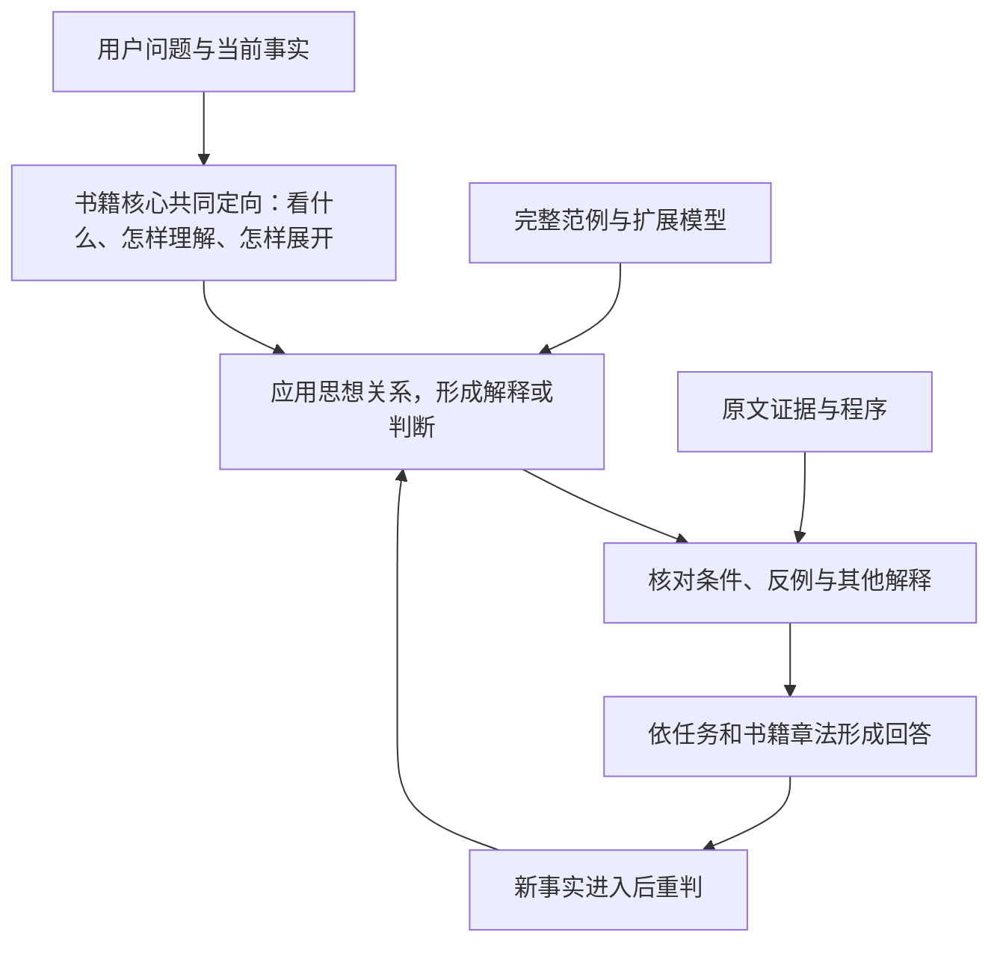

# 0.3.0 书籍思想与叙事能力升级方案

状态：第三轮方案，2026-10-23；思想与叙事编排、来源核查、候选、评测记录及发布限制已接入 0.3.0。实际运行合同见 [主技能](../../../skills/book-workflow/SKILL.md)，交付与验证范围见 [升级记录](../../releases/0.3.0.md)。本方案的整书目标仍须对每本书实际验收。

目标是让蒸馏后的 Skill **依据书中的思想理解新问题、形成可修正的判断，并以书中可辨认的叙事方式和口吻回答**。思想要影响它注意什么、怎样解释、如何取舍；文风要影响认识怎样一步步展开。检索负责取证，程序卡负责执行具体方法，两者共同支持这一目标。

本次修订保留第二轮的整书模型、来源核查、陌生任务和反事实测试，补齐思想运用示范、叙事与推演的结合、最终入口的规则冲突。先看本文，再看 [完整回答与入口示例](examples.md)。实现规格见 [runtime.md](runtime.md)，验证方法见 [methodology.md](methodology.md)。

## 一 当前问题的根源

### 现行产物围绕局部能力组织

现行流程优化的主要对象是可执行能力。上游三重验证已支持思想框架的新情境演练，也会保留参考材料，不能把它描述成“只会检索”或“把思想全部淘汰”。问题在于，这些内容最终被怎样组织和使用。

| 可核对的现状 | 对目标的影响 | 修订 |
|---|---|---|
| [single 编译器](../../../vendor/cangjie-skill/scripts/compile_single.py) 的 `build_entry_md` 要求先按意图读 1 张卡，跨域最多 2 张；索引未命中即告知超范围 | 开放问题和跨章推演容易被已有意图表截断 | 新整书入口负责理解和推演，程序索引只决定调用哪个具体工具 |
| [三重验证](../../../vendor/cangjie-skill/methodology/03-stage1.5-triple-verify.md) 将有价值但不能独立执行的内容放入 overview 或 glossary | 思想可能保存在包内，却没有参与日常回答的明确路径 | 核心关切、认识方式与价值关系进入入口，并附完整论证和迁移实例 |
| [RIA 模板](../../../vendor/cangjie-skill/templates/SKILL.md.template) 以方法骨架、触发、执行与边界组织局部能力 | 叙述视角、信息揭示顺序、叙述距离和口吻没有同等明确的产物位置 | 蒸馏这些内容，并将它们与思想动作相连 |
| [桥接器](../../../bridge/cangjie_to_dsh.py) 与 [四闸入口](../../../bridge/run_audit.py) 核查引文、池、锚、闭包和图件 | 原文命中不能证明解释忠实，也不能证明回答用该思想形成了新认识 | 保留四闸，增加语义核查和最终包的行为评测 |

### 第二轮方案还有的具体缺口

第二轮已提出概念、关系、推理动作与表达契约。方向可保留，但这些安排仍不足以兑现目标。

1. **关系登记多，完整的思想运用示范少。** `uses`、`move` 和 `blocked_by` 能登记依赖，却未必保留原书怎样发现问题、排除一种解释、形成另一种认识。需要连贯的思想说明与完整应用范例，验证它们是否比关系表独用有效。
2. **写作容易变成最后一次改口吻。** 第二轮默认先给判断再展开理由，示例集中在行动建议。对通过情景、视角、延迟揭示形成认识的作品，覆盖不足。
3. **“会思考”被测得偏窄。** 选择和建议之外，还应测解释现象、发现问题、生成假说、理解矛盾、阅读人物动机，以及在无法定论时保留几种解释。
4. **内容和风格的控制对照容易被误作生产流程。** 中性版与风格版适合测内容是否保持；实际回答应从一开始选好观察视角和展开方式，否则容易得到统一的咨询式答案，再加几处修辞。
5. **程序入口存在规则冲突。** 第二轮拟把上游 `SKILL.md` 改名 `ENTRY.md` 后原样打包。文件改名不会消除“一张卡”和“未命中即停止”。新版应打包已验程序卡、资源与调用索引，由整书入口统一管理，不装入上游总路由指令。
6. **合成示例的证明范围不足。** 两份短篇都偏短句论说，示范回答由方案编写者给出。它们能解释意图，不能证明真实书籍的思想或叙事已经被保留。

## 二 三种能力分别验收

| 能力 | 回答里应当发生什么 | 不能充当成功证据的表现 |
|---|---|---|
| 思想进入理解 | 用本书的重要区分重新组织事实；指出提问遗漏了什么或混淆了什么 | 报出书名、术语、格言，却仍给通用建议 |
| 思想参与推演 | 解释事实之间的关系，形成书里没有现成答案的判断；关键条件变化时修正 | 找到相似案例后照抄结论；一律用同一个原则 |
| 叙事与口吻进入回答 | 观察位置、材料顺序、读者关系、节奏和修辞服务于本次理解；短答与长答都可辨认 | 加口头禅、古语、固定比喻；所有书最终一种腔调 |

思考由宿主模型执行。Skill 提供可使用的思想结构、示范、证据和运行约束；普通文件不会改变模型权重。可验证的目标是在声明的模型和任务范围内，让这些材料稳定改变回答的理解与推演。无需收集完整内部思维过程，核对实际回答、关键依据和事实变化后的行为即可。

## 三 核心交付物

### 整书思想模型

先写出一段连贯说明：本书试图解决什么问题，它首先看见什么，怎样区分事物，什么证据能让它改变判断，价值冲突时怎样取舍。再登记支撑这段说明的命题与关系。

每个重要思想动作都应回答：在什么事实下有用；让人多看到什么；这些事实凭什么支持某种解释；哪种反例会使它失效；用于新情境时新增了什么假设。“比较”本身不算书籍特有的思想动作；比较什么、忽略什么、怎样处理不对称的代价，才可能体现该书。

小说与多声部作品允许保留互不统一的解释视角。人物的选择及后果可以帮助看见一种可能性，却不能直接升格成现实因果规律。不同类型的书共用来源纪律，按各自文本组织思想模型。

### 思想与叙事共同发生的完整范例

核心思想动作需要可阅读的应用范例：原书论证或叙事片段的重建、书外新情境、会改变判断的条件变体。多个动作可以共用一组范例，无须机械凑数。

范例展示输入、完整回答和简短依据说明。说明指出哪些事实对应哪些关系、哪里作了迁移、为什么不能直接套用旧结论。这是供核查的解释，不是模型内部思维记录。

范例保留“怎样走到一个认识”的经验。只给问题和答案容易学到情境模板；只给原则容易退回通用推理。二者配合是否有效，由移除范例的对照实验判断。

### 叙事和口吻规格

从原书连续段落观察以下内容，每项都有出处与适用语境：

| 部分 | 需要提取的内容 |
|---|---|
| 观察视角 | 谁在看、能知道什么、关注哪些细节、与对象保持多远距离 |
| 展开次序 | 从场景、问题、主张还是对话开始；何时补背景、转向另一视角、揭示条件 |
| 认识推进 | 反问、对比、反例、类比、细节或叙事转折怎样改变读者的理解 |
| 对读者的态度 | 共同探究、解释、劝说、质疑、讽刺或克制；何时变换力度 |
| 语言与节奏 | 句群长短、抽象与具体的比例、意象用途、反复、留白和收束方式 |
| 不变量 | 用这种写法时仍须保留的事实、限定、价值冲突和不确定性 |

这些是观察项目，不要求每本书都具有全部特征。中文译本记录译者与版本；目标口吻以实际提供的文本为准，不能把译者的全部语言特征直接归为作者本人。

真实问答不能为追求叙事而编造用户经历。可以从已知事实的细节切入；需要假设场景时明确标示。文学作品的留白也不能遮住用户必须知道的限制或紧急行动。

### 原文证据和程序能力

证据负责核查思想来源、说话者、上下文和反证；程序负责计算、流程与明确交付。直接查原文时允许直接检索；其他任务中，需要消除疑点、补足关系或确认来源时再展开证据。

思想、表达、范例共同进入新 Skill；证据与程序按需调用。不存在可执行程序的作品，也可以交付通过相应验证的思想与叙事 Skill。

## 四 回答时怎样工作

1. **理解实际需要。** 判断是查阅、解释、探索、决策、行动还是叙事写作。不要把每个问题都变成建议清单。
2. **同时选择思想视角与表达方式。** 核心告诉模型哪些事实重要、怎样区分、适合怎样展开。简答可以缩短展开，仍保持决定性的区分。
3. **让事实与思想发生联系。** 按需展开命题、反例与完整范例，形成候选解释。范例靠关系迁移，不能按表面相似套答案。
4. **检验推演。** 哪些前提已知、哪些暂定；另一种解释是否更能说明事实；什么信息会改变结论。存在实质竞争解释时才需要比较。
5. **自然成文。** 章法由书籍、任务和篇幅共同决定。允许先场景后认识、先疑问后分析、先结论后论证，不强制打印步骤、来源标签和边界标题。
6. **接受修正。** 新事实改变前提时，修正受影响的判断，保留仍成立的部分。会话应用不自动写回成原书主张。

“新推演”与“原书明言”必须能区分。说明可以自然嵌入关键句或来源注记，不要求每段重复审计术语。直接引文另行逐字核验。

书中的价值次序与用户目标冲突时，应把取舍说清，不能悄悄替用户换目标。书外事实可以作为当前分析的输入，但来源要与书中思想分开；需要最新事实时由用户提供或由宿主查询，不能让旧书替今天的事实作证。

## 五 蒸馏过程怎样改变

| 阶段 | 实际工作 | 可审核产物 |
|---|---|---|
| 整书阅读 | 固定版本、译者、范围；登记核心问题、论证或叙事结构、相反材料 | overview 与独立覆盖底账 |
| 联合重建 | 从同一批上下文重建思想及表达功能，核对跨章联系 | 思想模型、叙事口吻规格、来源说明 |
| 应用示范 | 重建原书的理解过程，写迁移回答与条件变体 | 完整范例及简短依据说明 |
| 程序整理 | 适用时沿用仓颉验证与能力 Bundle | 已验程序卡；无程序时说明适用性 |
| 候选构建 | 核查来源和结构，生成整书入口及引用 | 私有候选包及哈希清单 |
| 行为验证 | 干净会话处理未见问题，做条件变化与风格对照 | 完整输出、分项评审和失败分析 |
| 交付 | 发布与实测内容一致的产物 | 安装包、覆盖范围与验收记录 |

原书关键思想即使只出现一次，也按其作用评估。覆盖不能从已生成的卡片倒推。来源不足的关系标为待核查；没有原书依据的漂亮表达不能进入该书的口吻规格。

book-workflow 定义思想与叙事路径，仓颉继续定义程序路径。四件 vendor 源码保持原样。具体来源、加载和构建边界见 [runtime.md](runtime.md)。

## 六 怎样验证解决了问题

第二轮已有的陌生迁移、跨章综合、关键前提变化、无关变化、多轮修正、保留题与盲评继续采用。本轮增加：

- **解释和探索**：观察能否产生有书籍依据的新理解、关键问题或条件式解释，不要求每次给行动建议。
- **叙事和口吻**：分别评审视角、材料展开、语气、自然程度与内容保持，测试短答、长答及语体变化。
- **增益定位**：补充检索基线和移除完整范例的消融；保持思想相同而替换表达，保持表达相同而替换思想，辨认什么影响了回答。

思想忠实、迁移能力、表达效果分别报告，任一核心项失败不能靠另一项高分抵消。用户对完整回答的阅读反馈决定目标口吻是否达成；来源与推演质量仍须独立核查。

评测借鉴文本风格迁移研究对风格、内容保持、自然程度的区分。该研究主要使用情感迁移数据，不能直接证明文学叙事重建有效，本项目仍须结合原书语境与用户审阅。[Evaluating Style Transfer for Text](https://aclanthology.org/N19-1049/)

## 七 实现顺序与继续条件

### 先做真实书籍试点

使用一部有完整原文的书，选一个连通思想子系统，并覆盖足以支持目标叙事特征的连续文本。制作可加载入口、完整范例和来源记录。仅覆盖选篇时明确称为选篇试点。

提交实际回答对照：无该书 Skill、现有 Skill、原文检索基线、新 Skill。不存在旧版产物时如实记缺席。用未见问题检查增益，对关键任务复跑，保留失败。

继续条件是：新问题的理解与推演有来源依据；关键事实变化引起合理重判；用户能从完整回答辨认目标书的章法与口吻。未证明这些之前，先修内容、范例或运行方式，不扩大自动化。

### 再实现通用构建

固定试点验证过的字段与组装方法，新增自有核查、构建和结果汇总脚本。实现思想与表达必载、程序按需调用、禁止旧总路由混入的检查。加入负例回归，再运行 `make doctor` 与 `make e2e`。

### 最后扩大范围并发布

补齐整书覆盖，验证论说、实务和叙事类型的差异，再处理 pack、旧书补蒸馏与多宿主。源文本切片不能自动升级为思想模型，旧程序卡不能自动生成书籍口吻。真实包通过后，再更新主技能运行合同、命令、版本和四份清单。

第一版采用 Skill 内容、分层加载与范例，不引入训练服务或图数据库。分层上下文和少量多样范例可以作为实现起点，其在本项目的效果仍须实测。[Effective context engineering for AI agents](https://www.anthropic.com/research/effective-context-engineering-for-ai-agents)

若明确加载且材料充分后仍持续失败，按证据定位：思想失真则回源；范例只教会套题则换迁移设计；文风不稳定则补语体样本；推演能力不足则评估宿主模型或针对性训练。训练是后续经实验决定的路线，不能把“写了 Skill”称为已经训练出新模型。
